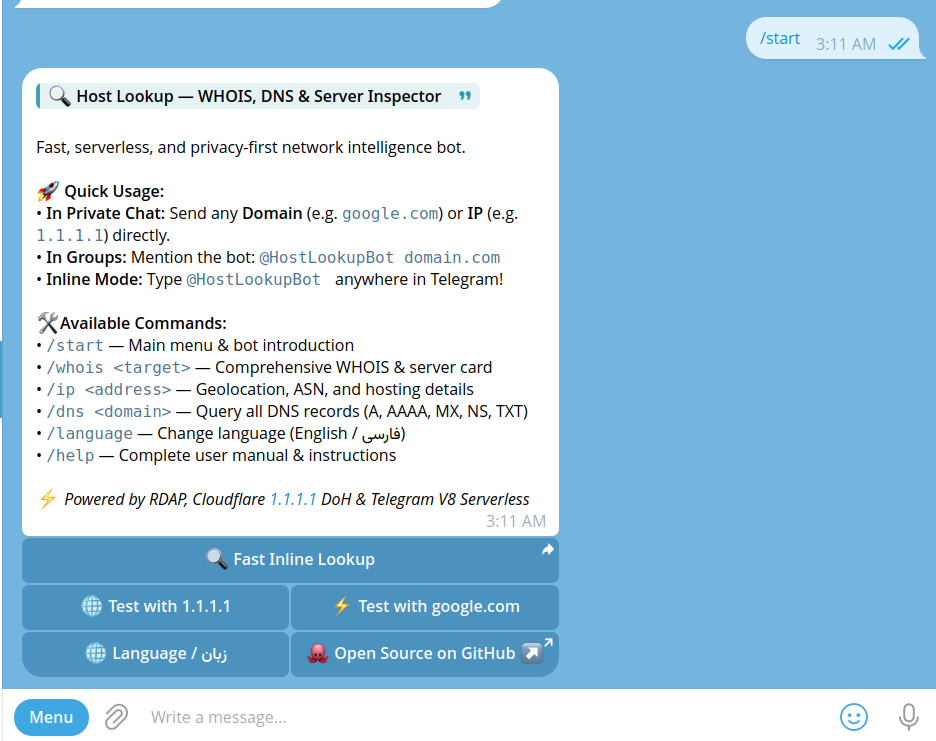
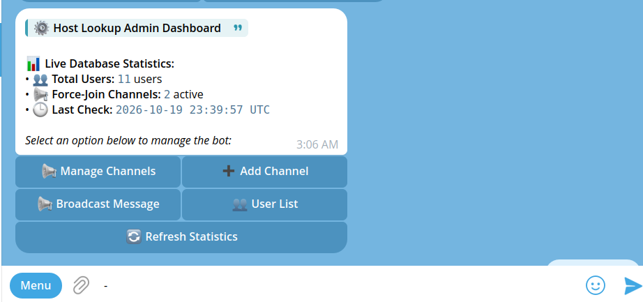
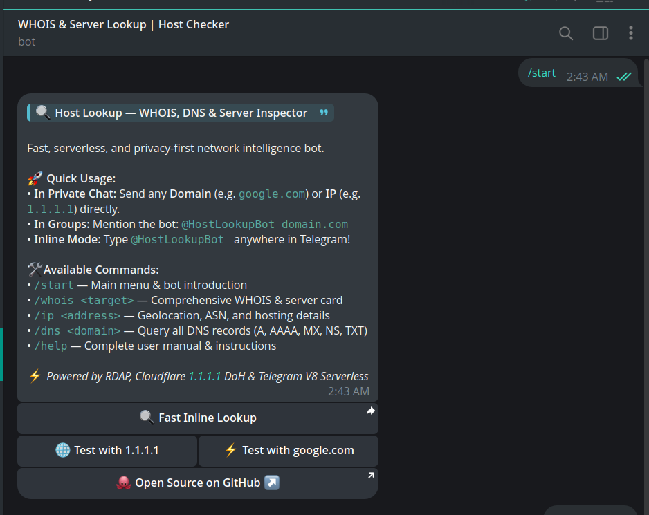
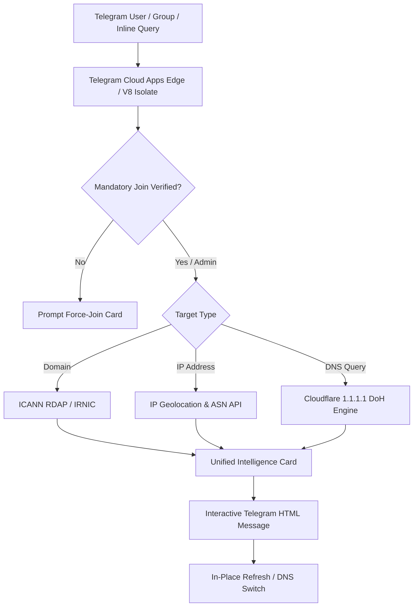

# Host Lookup Bot — Fast WHOIS, DNS & Server Intelligence 🔍

[](https://t.me/HostLookupBot)
[](https://t.me/dallrep)
[](https://cloud.telegram.org)
[](https://v8.dev)
[](https://cloudflare-dns.com)
[](LICENSE)

A high-performance, serverless Telegram bot for comprehensive **WHOIS**, **DNS records**, **IP geolocation**, and **server intelligence**. Designed to match the quality and speed of production network utility bots serving millions of users.

Built on Telegram's native serverless platform (**Telegram Cloud Apps**) — running on ultra-fast V8 isolates with zero server maintenance, zero cold-starts, and global high availability.

---

## 🌟 Key Features

- **🌐 Comprehensive WHOIS (RDAP Standard):**
  - Instant registrar identification & IANA registrar IDs.
  - Creation date, expiration date, and dynamic expiration countdown.
  - ICANN domain lifecycle status codes.
  - Nameserver (NS) extraction & DNSSEC verification.
  - Native support for ccTLD **`.ir`** domains via IRNIC registry data and DoH root resolvers.

- **🖥️ IP & Server Intelligence:**
  - High-precision geolocation (Country flag, City, Region, Coordinates).
  - ISP, Organization, and Datacenter / Hosting detection.
  - Autonomous System Number (ASN), AS Name, and BGP routing path.
  - Reverse DNS (PTR) lookup.
  - Direct one-click links to Google Maps coordinates and Check-Host latency/connectivity reports.

- **📡 DNS Record Resolver (Cloudflare DoH):**
  - Full DNS record inspection: `A`, `AAAA`, `MX`, `NS`, `TXT`, `CNAME`.
  - Powered by Cloudflare's privacy-focused 1.1.1.1 DNS over HTTPS.

- **⚡️ Telegram Inline Query Support:**
  - Type `@HostLookupBot domain.com` or `@HostLookupBot 1.1.1.1` in **any** Telegram chat or group for instant, shareable preview cards without adding the bot!

- **📢 Dynamic Force-Join & Admin Management (100% Serverless):**
  - Native channel membership verification via Telegram Bot API `getChatMember`.
  - In-app interactive admin panel: forward any channel message or send `@channel` to add it dynamically.
  - Automatic admin privilege verification and instant invite link generation.
  - Multi-channel support with per-channel join buttons and in-place re-verification (`check_fsub`).

- **🛡 Clean & Spam-Free UX:**
  - Modern Telegram blockquotes (`<blockquote>`) and expandable sections (`<blockquote expandable>`).
  - In-place single-message card updates (`editMessageText`) — zero chat pollution.
  - Full group chat compatibility with smart mentions and command routing.

---

## 🚀 Live Demo & Preview

<p align="center">
  
  
</p>

<p align="center">
  
</p>

- 🤖 **Live Bot on Telegram:** [@HostLookupBot](https://t.me/HostLookupBot)
- 📢 **Official Channel & Community:** [@dallrep](https://t.me/dallrep)
- 🐙 **GitHub Organization:** [dalroot](https://github.com/dalroot)

---

## 🛠 Commands & Usage

| Command | Description | Example |
| :--- | :--- | :--- |
| **`/start`** | Main menu & bot introduction | `/start` |
| **`/whois <target>`** | Comprehensive WHOIS & hosting card | `/whois github.com` |
| **`/dns <domain>`** | Query all DNS records (`A`, `AAAA`, `MX`, `NS`, `TXT`) | `/dns cloudflare.com` |
| **`/ip <address>`** | Inspect IP geolocation, ASN & hosting provider | `/ip 1.1.1.1` |
| **`/language`** | Change interface language (English 🇬🇧 / فارسی 🇮🇷) | `/language` |
| **`/help`** | Complete user manual & instructions | `/help` |
| **Direct Send** | Send any domain or IP directly in private chat | `google.com` or `8.8.8.8` |
| **Inline Mode** | Query directly from any chat in Telegram | `@HostLookupBot 1.1.1.1` |

---

## 🏗 Architecture



---

## 📦 Self-Hosting & 100% Serverless Deployment

This project runs natively on **Telegram Cloud Apps** (V8 Isolates) — requiring **zero VPS**, zero SSL certificate configuration, zero cron setup, and zero monthly server hosting bills.

### Prerequisites
- Node.js 18+ & npm
- A Telegram account and a bot created via [@BotFather](https://t.me/BotFather)

### Step-by-Step Serverless Setup:

1. **Clone the repository:**
   ```bash
   git clone https://github.com/dalroot/host-lookup-bot.git
   cd host-lookup-bot
   ```

2. **Configure Your Admin Telegram ID:**
   Open `tgcloud/handlers/message.js` and `tgcloud/handlers/callback_query.js` and set your numeric Telegram ID:
   ```javascript
   export const ADMIN_ID = YOUR_TELEGRAM_NUMERIC_ID; // e.g. 8629398713
   ```

3. **Authenticate with Telegram Cloud:**
   Login using your bot token from @BotFather:
   ```bash
   npx @tgcloud/cli login
   ```
   *(Enter your Bot Token when prompted).*

4. **Deploy Code into Telegram's Global V8 Isolates:**
   ```bash
   npx @tgcloud/cli push
   ```

5. **Verify Live Deployment:**
   Check the deployment status and logs:
   ```bash
   npx @tgcloud/cli status
   ```
   Open your bot on Telegram and send `/start`. The bot will immediately register commands and initialize the SQLite database table schema.

6. **Add Your Community Channel to Force-Join:**
   In your private chat with the bot, send `/admin` or `/panel`, click **`➕ افزودن کانال جدید`**, and simply forward any message from your channel to the bot!

---

## 📜 License & Terms of Use

This software is released under the **GNU Affero General Public License v3.0 (AGPLv3)** with **Mandatory Attribution and Non-Commercial Restrictions**:

1. **Attribution:** Any fork, redistribution, or hosted instance MUST preserve original credit to **Dall (@dalroot / @dallrep)** and link to this upstream repository.
2. **Non-Commercial:** This software is free for public use. **Re-branding, closed-source repackaging, or commercial resale is strictly prohibited.**

See the full [LICENSE](LICENSE) file for complete details.

---

<div dir="rtl">

### راهنمای فارسی (معرفی پروژه و جامعه دال)

ربات **Host Lookup** یک ابزار بازمتن، پرسرعت و سرورلس برای استعلام دقیق و استاندارد **WHOIS دامنه**، **رکوردهای DNS**، **مشخصات سرور و موقعیت IP** در بستر ابری تلگرام است که توسط تیم **دال (Dall)** توسعه داده شده است.

#### 🔗 جامعه و کانال رسمی:
• **کانال رسمی دال:** [@dallrep](https://t.me/dallrep)  
• **ربات لایو تلگرام:** [@HostLookupBot](https://t.me/HostLookupBot)  
• **مخازن گیت‌هاب:** [github.com/dalroot](https://github.com/dalroot)

#### امکانات کلیدی:
• **هویز کامل دامنه:** اطلاعات ثبت‌کننده، تاریخ ثبت و انقضا، وضعیت و نیم‌سرورها (پشتیبانی کامل از دامنه‌های بین‌المللی و ایرانی `.ir`).  
• **اطلاعات سرور و IP:** موقعیت جغرافیایی، نام دیتاسنتر و هاستینگ، شماره خودمختار (ASN) و Reverse DNS.  
• **رکوردهای دی‌ان‌اس:** استعلام زنده رکوردهای A، AAAA، MX، NS و TXT از طریق سرورهای Cloudflare DoH.  
• **حالت اینلاین (Inline):** استفاده مستقیم در تمامی گروه‌ها و چت‌ها با تایپ `@HostLookupBot`.  
• **سیستم جوین اجباری داینامیک:** امکان افزودن نامحدود کانال با فوروارد پیام و بررسی زنده عضویت کاربران.  
• **معماری ۱۰۰٪ سرورلس:** بدون نیاز به سرور اختصاصی (VPS) یا داون‌تایم، با اجرای پایدار در ایزوله‌های V8 تلگرام.

</div>
